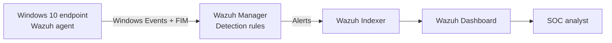

# SOC Home Lab — Wazuh SIEM & Detection Engineering

**Defensive Security · Windows Telemetry · Detection Validation · SOC L1**

> A hands-on Windows and Wazuh lab for investigating security events, validating file integrity alerts, and testing custom detection logic.

**Project status:** Core lab implementation and saved monitoring dashboard **completed** · Written case studies **completed** · Screenshot privacy review **pending** · Repository **private** until final review.

## Project at a glance

I built and operated a small virtual SOC lab to learn how endpoint activity becomes a security alert, and how to decide what the evidence actually proves. The workflow goes beyond opening a dashboard: each exercise checks the relevant event fields, compares the local log with Wazuh output when possible, and records the difference between a **detection** and a **confirmed incident**.

| Component | Implementation |
| --- | --- |
| SIEM | Wazuh 4.14.8 — manager, indexer and dashboard |
| Monitored host | Windows 10 VM with Wazuh agent |
| Virtualization | Oracle VirtualBox on Windows 11 |
| Host-only lab segment | `192.168.56.0/24` (local test network) |
| Telemetry | Windows Security, PowerShell Operational and Wazuh FIM |
| Custom detection | Rule **100100**, file-specific FIM alert |
| Analyst dashboard | **SALEM \| SOC COMMAND CENTER** — five visualizations |

See [lab architecture and telemetry flow](architecture/README.md).

## Architecture



The network details, communication tests and scope limitations are documented in [Architecture](architecture/README.md).

## Case studies

| Case | Focus | Outcome | Technical write-up |
| --- | --- | --- | --- |
| 001 | PowerShell transcription / SCA | Missing policy identified, enabled and rechecked as **Passed** | [Read case](investigations/CASE-001-powershell-transcription.md) |
| 002 | Windows Event **4625** | Controlled failed sign-in triaged using logon type, status and source address | [Read case](investigations/CASE-002-failed-logon.md) |
| 003 | PowerShell Event **4104** | Local event **878** correlated to Wazuh rule **91843** | [Read case](investigations/CASE-003-powershell-4104.md) |
| 004 | File Integrity Monitoring | Test-file modification detected by rule **550**; SHA-256 change verified | [Read case](investigations/CASE-004-fim.md) |

**Important:** The detected registry and file modifications were intentional lab actions. A matching rule is not, on its own, evidence of malicious activity. A separate remote-login brute-force example was an analyst training scenario, **not** a captured incident.

## Custom detection engineering

A custom rule detects a change to one deliberately protected test file:

- Rule **100100**, level **9** (priority chosen for this lab).
- Extends the default Wazuh FIM modification rule **550**.
- Matches `C:\SOC-Lab-FIM\important.txt`, not every file in the directory.
- **Positive test passed:** changing that file generated a rule 100100 alert.
- **Negative test passed in observed window:** changing `other-test.txt` generated a standard FIM alert without generating a new rule 100100 alert.

**Source and test steps:** [Detection engineering](detection-rules/README.md) · [Custom rule XML](detection-rules/soc_lab_fim.xml)

## SOC monitoring dashboard

**SALEM | SOC COMMAND CENTER** was saved and verified to refresh with all five panels:

| Panel | What it helps answer |
| --- | --- |
| Total Security Alerts | How much detected alert activity is present? |
| Alert Severity Distribution | Which Wazuh rule levels dominate the alert count? |
| PowerShell Activity Timeline | When do alerted PowerShell 4104 events cluster? |
| File Integrity Monitoring | When are monitored-file changes producing alerts? |
| Custom Detection Alerts | How many alerts matched rule 100100 in the selected window? |

[Dashboard configuration, interpretation and validation](dashboard/README.md)

All counts depend on the selected time range and active filters; the dashboard does not count every raw Windows event.

## Investigation method

**Alert → Validate event → Gather context → Assess impact → Decide action → Document evidence**

For every case, I separate:
- **Observed facts:** event ID, rule ID, event record, hash, path, timestamp, etc.
- **Interpretation:** what those fields establish, and what they do **not** establish.
- **Next steps:** missing process/user context, change authorization, related events and disposition.

## Troubleshooting and lessons learned

The lab involved diagnosing a Wazuh manager startup timeout, agent deployment issues, constrained VM performance, PowerShell session/logging behavior, and successful vs. non-matching rule tests.

See [Troubleshooting notes](troubleshooting/README.md).

## Evidence and publication status

An organized source archive contains **39 selected screenshots** (from an original set reported as 228). These include lab setup, Wazuh alerts, Windows Event Viewer, FIM hashes, custom-rule validation and visualization drafts. **Raw screenshots are not committed yet** because privacy review and final selection are still outstanding.

The final assembled/saved dashboard screenshot was captured later than the organized archive and must be reviewed separately.

See [Evidence review and publication checklist](evidence/README.md).

## Repository structure

```text
.
├── README.md
├── architecture/
│   └── README.md
├── investigations/
│   ├── CASE-001-powershell-transcription.md
│   ├── CASE-002-failed-logon.md
│   ├── CASE-003-powershell-4104.md
│   └── CASE-004-fim.md
├── detection-rules/
│   ├── README.md
│   └── soc_lab_fim.xml
├── dashboard/
│   └── README.md
├── evidence/
│   └── README.md
└── troubleshooting/
    └── README.md
```

## Scope and transparency

This is a **personal training project**, not a production SOC deployment or a claim of workplace incident-response experience.

I configured the lab, performed the tests, examined the resulting Windows/Wazuh evidence, and validated the detection behavior. **AI-assisted guidance** was used for explanations, troubleshooting suggestions, command/configuration examples and documentation support. The technical claims in this repository are tied to actions and results verified in the actual lab—not to AI-generated simulations.

---

**Maintainer:** [cyber-salem](https://github.com/cyber-salem)  
**Next steps:** Review and redact evidence; add selected screenshots; review the repository before making it public.
