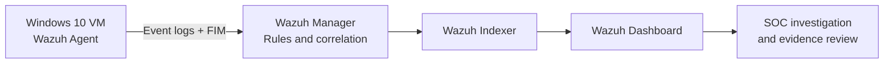

# Wazuh SOC Home Lab

**SOC Analyst L1 · Blue Team · Windows Event Investigation · Detection Engineering**

[العربية](README-AR.md) · [Case Studies](investigations/) · [Custom Detection](detection-rules/README.md) · [Evidence Gallery](evidence/GALLERY.md) · [Lab Runbook](operations/LAB-RUNBOOK.md)

I built a Windows-and-Wazuh home lab to practice a junior SOC analyst's workflow: **collect endpoint events, verify alerts, analyze context, test detection logic, and document a defensible conclusion.** Every case in this repository comes from controlled actions in a personal virtual lab.

## Final result — SALEM | SOC COMMAND CENTER

*Saved Wazuh dashboard, not a mockup. The captured view showed 1,716 alerts and one custom-rule alert for the selected time window; counts change with time and filters.*

### What I built and verified

| Area | Hands-on result | Evidence / details |
| --- | --- | --- |
| **SOC monitoring** | Connected Windows agent to Wazuh 4.14.8; built and saved a five-panel dashboard | [Agent connected](assets/screenshots/wazuh-agent-active.png) · [Dashboard guide](dashboard/README.md) |
| **Windows authentication** | Analyzed a controlled failed sign-in using Event ID **4625** and Wazuh rule **60122** | [Case 002](investigations/CASE-002-failed-logon.md) |
| **PowerShell telemetry** | Correlated Event ID **4104**, EventRecordID **878**, and Wazuh rule **91843** | [Case 003](investigations/CASE-003-powershell-4104.md) |
| **File integrity** | Detected an authorized file change with rule **550** and verified its SHA-256 difference | [Case 004](investigations/CASE-004-fim.md) |
| **Detection engineering** | Created rule **100100** (level 9) and validated it with positive and negative tests | [Rule source](detection-rules/soc_lab_fim.xml) · [Testing notes](detection-rules/README.md) |
| **Security configuration** | Enabled PowerShell transcription and verified the Wazuh SCA control passed | [Case 001](investigations/CASE-001-powershell-transcription.md) |

## Investigation evidence

| PowerShell event correlation | Custom FIM detection |
| --- | --- |
|  |  |
| Event **4104** / Wazuh rule **91843** | Rule **100100**, level **9**, `syscheck.event: modified` |

More evidence, including original Windows and Wazuh views: **[Screenshot gallery](evidence/GALLERY.md)**.

## Lab design

| Component | Implementation |
| --- | --- |
| Hypervisor | Oracle VirtualBox |
| SIEM | Wazuh **4.14.8**: manager, indexer, dashboard |
| Endpoint | Windows 10 VM / Wazuh agent **4.14.8** |
| Network | Local host-only segment plus NAT where needed for updates |
| Telemetry | Windows Security, PowerShell Operational, Wazuh FIM |
| Scope | One Windows endpoint in a **training environment**, not a production SOC |

[Architecture, connectivity, and telemetry flow](architecture/README.md)

## Four practical case studies

| Case | Scenario | Analyst disposition |
| --- | --- | --- |
| [001 — PowerShell transcription](investigations/CASE-001-powershell-transcription.md) | Security configuration assessment failed; authorized remediation and retest | **Configuration finding remediated** |
| [002 — Failed logon](investigations/CASE-002-failed-logon.md) | Event 4625; evaluated logon type, status and loopback source | **Benign, intentional test** |
| [003 — Script block logging](investigations/CASE-003-powershell-4104.md) | Generated a benign Registry test and correlated local/Wazuh Event 4104 | **Expected detection of authorized activity** |
| [004 — File modification](investigations/CASE-004-fim.md) | Compared SHA-256 before/after, inspected Wazuh integrity alert | **Change detected; actor not attributed by FIM** |

**Investigation method:** Alert → Validate event → Gather context → Compare evidence → Decide disposition → Document limitations.

### Detection test: positive *and* negative

The [custom Wazuh rule](detection-rules/soc_lab_fim.xml) extends built-in file-change rule **550** and applies to one controlled lab file, `C:\SOC-Lab-FIM\important.txt`.

- **Positive:** Editing that file generated a custom **100100** alert.
- **Negative:** Editing a different monitored file generated a normal FIM event but **no new 100100 alert in the observed test window**.
- **Interpretation:** A match establishes that the monitored file changed; it does **not** identify a malicious actor.

[Detection write-up and test procedure](detection-rules/README.md)

## What I learned

- An event, an alert and a confirmed incident are not interchangeable.
- Wazuh **rule level** indicates configured alert priority, not conclusive incident severity.
- EventRecordID, timestamps, rule IDs and SHA-256 values help verify that two records refer to the same activity.
- Investigative commands can themselves generate telemetry; source attribution matters.
- Testing a rule against a non-matching action is important alongside positive testing.
- Troubleshooting service state, agent connectivity and logging pipelines is part of operating a lab.

[Real setup problems and fixes](troubleshooting/README.md) · [Scope and limitations](docs/LIMITATIONS.md)

## Explore the repository

| Section | What's inside |
| --- | --- |
| [Investigations](investigations/) | Four case reports with observations, analyst reasoning and conclusions |
| [Detection rules](detection-rules/README.md) | Custom rule XML, deployment, test matrix and limitations |
| [Evidence gallery](evidence/GALLERY.md) | Curated screenshots, captions and full-resolution links |
| [Architecture](architecture/README.md) | Lab network and Windows-to-Wazuh telemetry |
| [Dashboard](dashboard/README.md) | Panel definitions, filtering and usage |
| [Troubleshooting](troubleshooting/README.md) | Actual failures, fixes and lessons learned |
| [Runbook](operations/LAB-RUNBOOK.md) | Safe startup, health checks and shutdown |
| [Limitations and next steps](docs/LIMITATIONS.md) | Explicit boundary between completed work and future ideas |

## About the project and use of AI

This is a **personal learning project**, not a production deployment or a claim of professional SOC employment.

I configured and operated the environment, generated controlled tests, reviewed the Windows and Wazuh output, and validated the results. I used **AI as a supporting learning and documentation tool** for explanations, troubleshooting suggestions, command/configuration examples and writing assistance. Technical conclusions are grounded in the lab's observed evidence, not in AI-generated scenarios.

**Privacy:** The repository is currently private. Selected screenshots have been cropped to remove irrelevant interface areas; a final human review for public visibility is still required. No credentials or tokens are intended to be shared. See the [pre-publication checklist](evidence/README.md).

---

**Maintainer:** [cyber-salem](https://github.com/cyber-salem) · **Target field:** SOC Analyst L1 / Defensive Security
