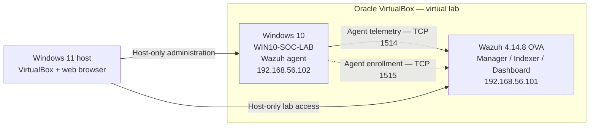

# Lab architecture and telemetry flow

## Purpose

The lab demonstrates a small, controlled SOC workflow from a Windows endpoint to Wazuh detections and analyst review. It is a **training environment**, not a production network.

## Logical topology

The VMs were configured with host-only connectivity for lab communication and NAT where needed for updates. The private `192.168.56.0/24` addresses refer to this local training network; they are not public Internet addresses.

## Collection and analysis path

1. A Windows action produces an event (for example, PowerShell event `4104`).
2. The Windows Event Log channel is collected by the Wazuh agent when configured.
3. The agent sends data to the Wazuh manager.
4. Decoders and rules evaluate the event; matching rules generate alerts.
5. Wazuh indexes the alert and makes it available in Threat Hunting / dashboards.
6. An analyst examines the original data fields, context and outcome.

File Integrity Monitoring (FIM) works differently: the Wazuh agent's `syscheck` module tracks configured local paths and reports filesystem changes.

## Key sources used

| Source | Example fields / evidence |
| --- | --- |
| Windows Security Log | Event ID 4625, logon type, status, source network address |
| Microsoft-Windows-PowerShell/Operational | Event ID 4104, script block text, ScriptBlock ID, EventRecordID |
| Wazuh FIM / syscheck | `syscheck.path`, `syscheck.event`, SHA-256, realtime mode |
| Wazuh detection metadata | `rule.id`, `rule.level`, description and groups |

## Lab verification

- Confirmed Windows agent status as `Active` in Wazuh.
- Tested connectivity from the Windows guest to Wazuh on TCP 1514 and 1515.
- Correlated Windows event 4104 record `878` with its Wazuh alert.
- Observed rule 550 on authorized test-file modifications.
- Validated custom rule 100100 with matching and non-matching file changes.

## Boundaries

- One connected Windows endpoint, not a multi-endpoint fleet.
- NAT is used in part of the virtual setup: **host-only is not equivalent to complete network isolation**.
- No production data, enterprise identity provider, or attack traffic dataset is claimed.
- Architecture screenshots are pending privacy review before inclusion.
