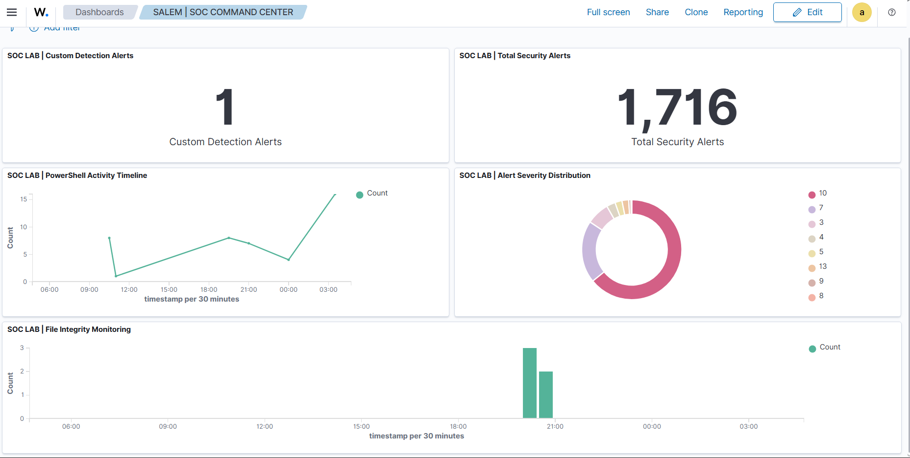

# SALEM | SOC COMMAND CENTER

**Status:** Saved in Wazuh and confirmed to refresh normally.

*Actual saved dashboard, captured during a particular 24-hour window. Values will change with filters and refresh.*

## Purpose

The dashboard provides a single view of selected alert statistics and lab detections from **WIN10-SOC-LAB**. It is intended for practicing SOC L1 event triage, not for proving continuous 24/7 production monitoring.

## Five saved visualizations

| Panel | Type | Data/filter | Interpretation |
| --- | --- | --- | --- |
| SOC LAB \| Total Security Alerts | Metric | `Count` on `wazuh-alerts-*`, Windows-agent filter | Total **alerts**, not all raw endpoint events |
| SOC LAB \| Alert Severity Distribution | Donut/Pie | Terms of `rule.level`, size 15 | Frequency of rule levels; bigger segment ≠ higher severity |
| SOC LAB \| PowerShell Activity Timeline | Line | Event `4104`, date histogram, Count | Time distribution of **alerted** PowerShell script blocks |
| SOC LAB \| File Integrity Monitoring | Vertical bar | `rule.groups: "syscheck"`, date histogram | FIM-related alert activity |
| SOC LAB \| Custom Detection Alerts | Metric | `rule.id: 100100`, Count | Number of custom protected-file detections in selected period |

**Data source:** `wazuh-alerts-*`  
**Time field in observed visualization editor:** `timestamp`  
**Common endpoint filter:** `agent.name is WIN10-SOC-LAB`

The dashboard title is **SALEM | SOC COMMAND CENTER**.

## Validation performed

- All five saved panels were assembled into one dashboard.
- The dashboard was saved and reopened in view mode.
- Refresh completed with all five panels visible.
- A temporary global filter `rule.level: 10` was removed after it caused the other panels to show incomplete results. This is expected dashboard-level filtering behavior.

## Analyst usage

1. Set and verify the time range (for example, Last 24 hours).
2. Confirm that no unintended global filter is applied.
3. Review total alert volume and severity levels.
4. Examine PowerShell and FIM spikes and drill into source events.
5. Use a custom-rule hit as a **triage lead**, then inspect the full event, actor context and authorization.

Counts such as **1,716 total alerts / 1 custom alert** were observed in one captured 24-hour view. They are illustrative, not fixed KPIs.

## Improvement ideas

- Add a table of recent alerts with timestamp, source, rule and affected path.
- Add explicit analyst-priority categories in addition to numeric Wazuh rule levels.
- Add an indicator for agent availability and telemetry freshness.
- Optional: add folder-level monitoring coverage and further negative tests.

## Screenshots

The **final saved dashboard** screenshot has been cropped to retain the five panels and committed to this **private** repository. The five older visualization images in the source archive are only editing-stage drafts. See [Evidence gallery](../evidence/GALLERY.md).
