# Evidence gallery — verified SOC lab activities

[← Main project page](../README.md) · [Case reports](../investigations/) · [Screenshots policy](README.md)

All screenshots below come from the controlled Wazuh/Windows lab. The cropped PNGs preserve the displayed **rule IDs, event IDs, timestamps and hashes**. The source archive remains available separately; crops are presentation derivatives, not edited logs.

**Publication scope:** these images are committed to the **private** GitHub repository. Before making the repository public, check personally identifying labels and lab system details.

## 1. Saved SOC command center

*Saved dashboard with five panels. Alert counts depend on the selected time range and active filters. The count of 1,716 is not a count of confirmed incidents.*

[Dashboard setup and validation](../dashboard/README.md)

## 2. Wazuh agent and connectivity

[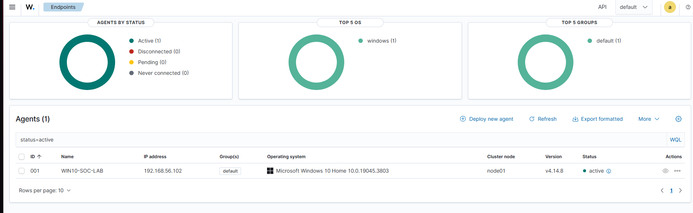](../assets/screenshots/wazuh-agent-active.png)

*The Windows lab endpoint is active in Wazuh.*

Supporting detail: [TCP 1514/1515 connectivity test](../assets/screenshots/agent-connectivity-1514-1515.png).

## 3. Windows Event 4625 — failed local sign-in

| Windows evidence | Wazuh alert |
| --- | --- |
| [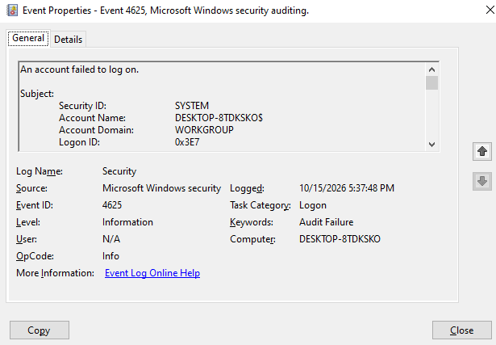](../assets/screenshots/event-4625-windows.png) | [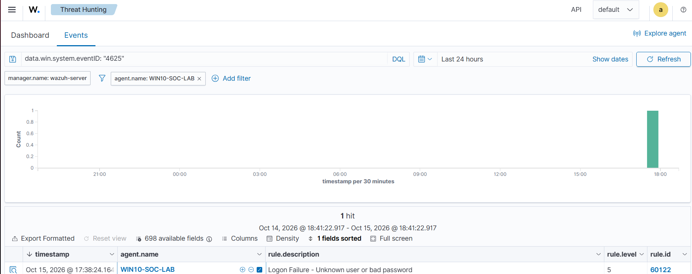](../assets/screenshots/event-4625-wazuh.png) |

*Event 4625 was generated by an authorized failed sign-in. Wazuh rule **60122** reported the event. The original case data include Logon Type **2** and loopback source **127.0.0.1**. This is not evidence of a remote brute-force attack.*

[Read Case 002](../investigations/CASE-002-failed-logon.md)

## 4. PowerShell Event 4104 — cross-source validation

| Windows PowerShell Operational | Wazuh Document Details |
| --- | --- |
| [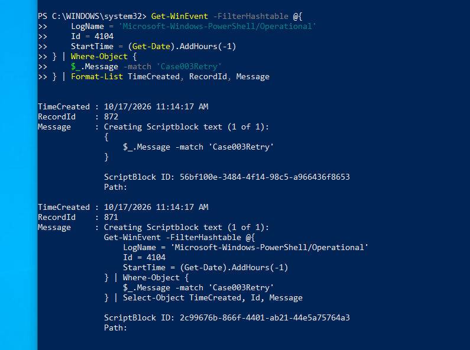](../assets/screenshots/event-4104-windows-local.png) | [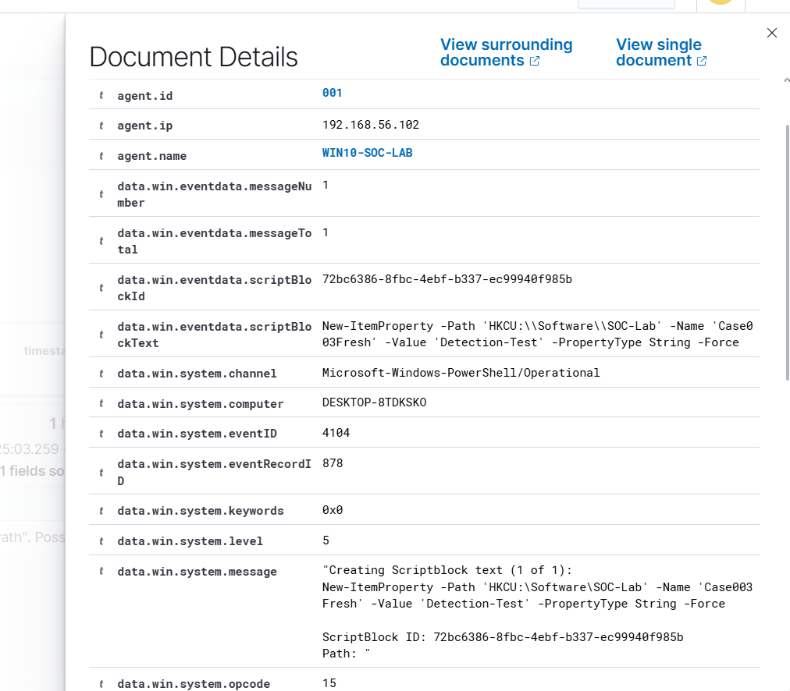](../assets/screenshots/event-4104-wazuh-correlation.png) |

*Matched Event ID **4104** and EventRecordID **878** to Wazuh rule **91843**. The script block shows the benign, intentional `Case003Fresh` test.*

[Read Case 003](../investigations/CASE-003-powershell-4104.md)

## 5. File Integrity Monitoring — hash verification

| Baseline SHA-256 | SHA-256 after file modification |
| --- | --- |
| [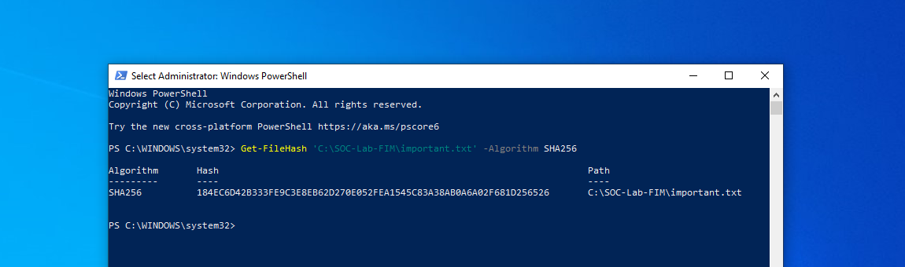](../assets/screenshots/fim-sha256-before.png) | [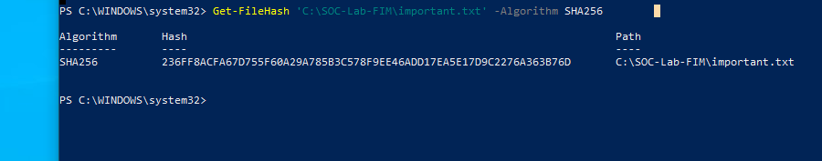](../assets/screenshots/fim-sha256-after.png) |

[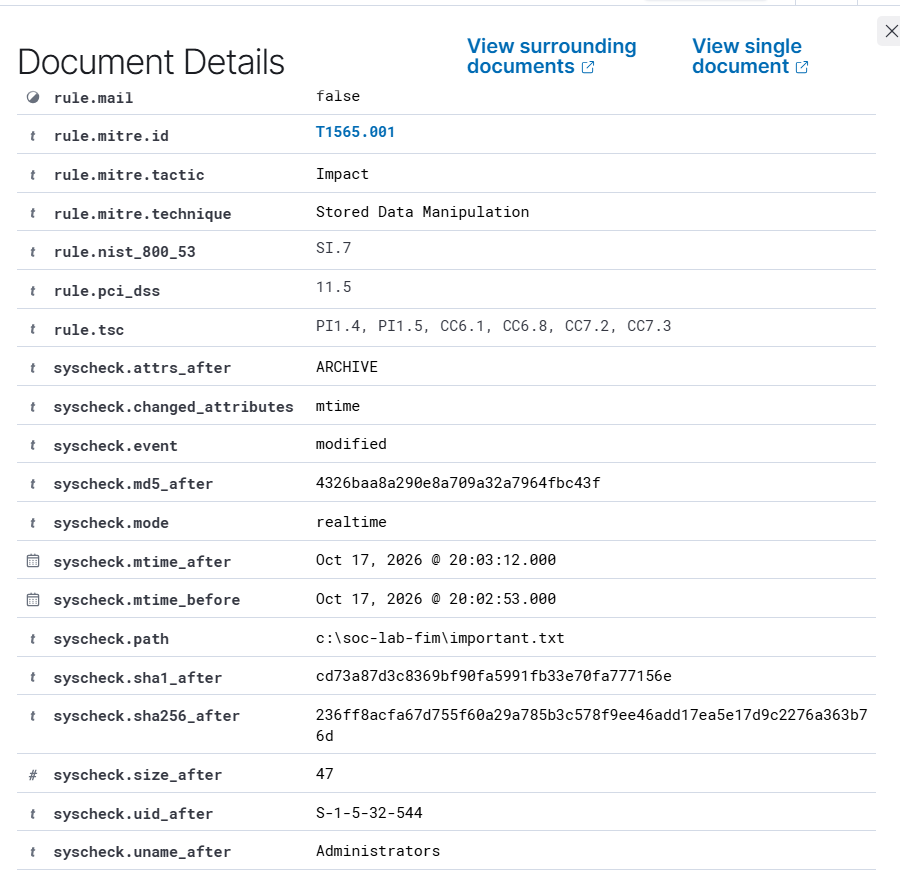](../assets/screenshots/fim-rule-550-hashes.png)

*The file checksum changed; Wazuh rule **550** and `syscheck` fields reflect a monitored modification. The SHA-256 value generated locally after the edit matched the alert's `syscheck.sha256_after`.*

[Open full FIM alert search](../assets/screenshots/fim-rule-550-hit.png) · [Read Case 004](../investigations/CASE-004-fim.md)

## 6. Custom Wazuh detection rule 100100

| Rule match | Detailed evidence |
| --- | --- |
| [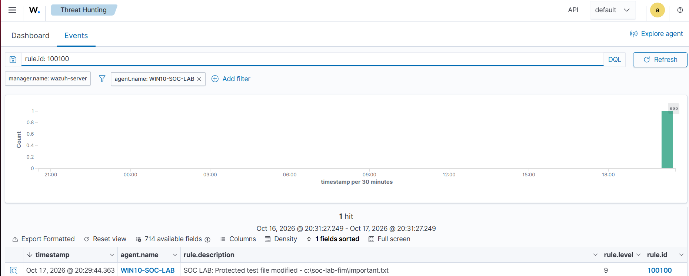](../assets/screenshots/custom-rule-100100-hit.png) | [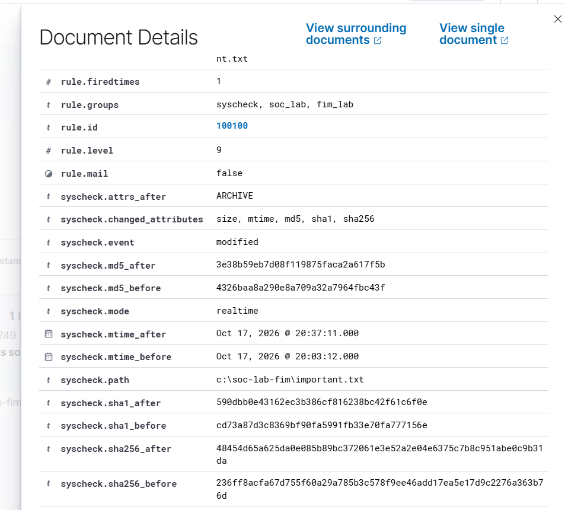](../assets/screenshots/custom-rule-100100-fields.png) |

*The custom level-9 rule matched the protected test file. The negative test used a different file in the same watched folder and did not produce a new 100100 hit in the observed test window.*

[Rule validation / manager restart evidence](../assets/screenshots/custom-rule-validation.png) · [Source and test matrix](../detection-rules/README.md)

## 7. PowerShell hardening check

[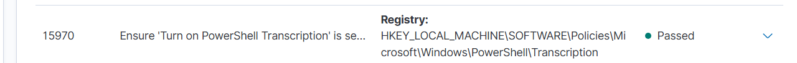](../assets/screenshots/sca-transcription-passed.png)

*The Wazuh SCA check was observed as **Passed** after the corresponding lab policy setting was enabled. This does not imply the whole endpoint is compliant.*

[Read Case 001](../investigations/CASE-001-powershell-transcription.md)

---

## Integrity and review notes

- The images above were copied from the provided evidence pack, then **cropped only**. Cropping does not establish new facts or replace original logs.
- All 15 derivative image files have a local SHA-256 manifest in the companion asset export.
- Images from the five draft visualization editors are **not** used as final dashboard evidence.
- Private lab IPs/host labels visible in some screenshots are illustrative local environment details; re-review them before public release.
- Avoid treating a "true positive detection of authorized test activity" as a confirmed malicious incident.
